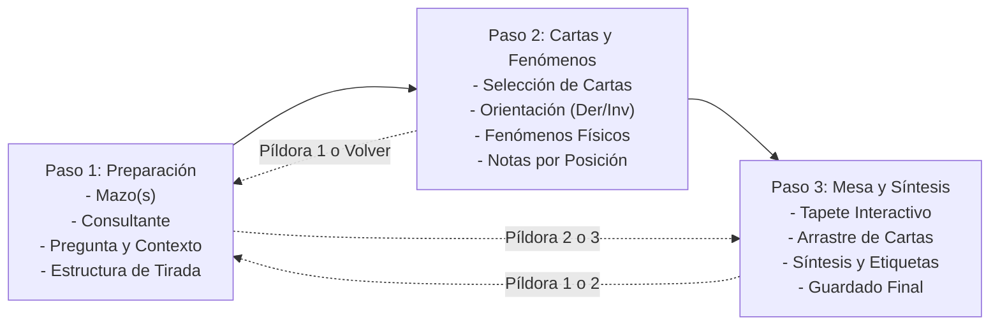

# Grimorio — Mesa de Trabajo, Agenda y Biblioteca Personal para Tarotistas

**Grimorio** es una aplicación web y PWA profesional diseñada específicamente para tarotistas y practicantes que operan con **mazos físicos sobre el paño de lectura**. Desarrollada bajo una filosofía de **soberanía de datos, privacidad ética y diseño editorial sereno**, la plataforma elimina por completo la fricción administrativa y cognitiva en consulta, permitiendo registrar tiradas, consultantes, acontecimientos materiales de las cartas y aprendizajes arquetípicos sin perturbar el acto adivinatorio.

---

## Índice

1. [Filosofía y Principios de Diseño](#1-filosofía-y-principios-de-diseño)
2. [Catálogo Completo de Funcionalidades](#2-catálogo-completo-de-funcionalidades)
3. [Flujos de Trabajo y Guía de Casos de Uso](#3-flujos-de-trabajo-y-guía-de-casos-de-uso)
   - [Flujo Principal: Asistente de Lectura en 3 Pasos](#flujo-principal-asistente-de-lectura-en-3-pasos)
   - [Casos de Uso Alternativos y Excepcionales](#casos-de-uso-alternativos-y-excepcionales)
4. [Estructura del Proyecto y Directorios](#4-estructura-del-proyecto-y-directorios)
5. [Seguridad, Criptografía y Arquitectura de Sesiones](#5-seguridad-criptografía-y-arquitectura-de-sesiones)
6. [Configuración de Variables de Entorno (.env.example)](#6-configuración-de-variables-de-entorno-envexample)
7. [Instalación, Desarrollo y Despliegue](#7-instalación-desarrollo-y-despliegue)
8. [Arquitectura Técnica y Patrones de Diseño](#8-arquitectura-técnica-y-patrones-de-diseño)

---

## 1. Filosofía y Principios de Diseño

### ¿Por qué existe Grimorio?
La gran mayoría del software de tarot en el mercado consiste en simuladores lúdicos basados en números pseudoaleatorios (*RNG*). **Grimorio no es un juego ni simula tiradas automáticas**: es un instrumento de trabajo, documentación y estudio para el profesional que baraja, corta y dispone cartas físicas en una mesa real.

```
       [ Acto Material ]                   [ Registro en Grimorio ]
  Cartas físicas sobre el paño   ───►  Mesa interactiva + Tapete visual
  Sucesos físicos (saltos, caídas) ───►  Observatorio de fenómenos
  Diálogo con el consultante     ───►  Notas contextuales + Síntesis
  Revelación arquetípica         ───►  Grimorio personal evolutivo
```

### Principios Fundamentales:
- **Separación de planos epistemológicos**:
  1. *El hecho material*: qué carta salió, de qué mazo, en qué posición y orientación (derecha / invertida).
  2. *La interpretación contextual*: qué mensaje se transmitió al consultante en función de su circunstancia.
  3. *El aprendizaje del tarotista*: reflexiones íntimas y conexiones simbólicas que nutren el Grimorio personal a largo plazo.
- **Privacidad y confidencialidad ética**: Los consultantes tratan temas profundamente íntimos. Grimorio permite operar únicamente con nombres de pila o seudónimos, sin exigir teléfonos, correos ni datos sensibles innecesarios.
- **Navegación sin sobrecarga cognitiva**: Flujo guiado en 3 pasos con posibilidad de navegación bidireccional inmediata, autoguardado de borrador y protecciones contra pérdida de datos.
- **Estética editorial pastel y anti-slop**: Tipografías clásicas serif/sans, acabado símil papel lino, tonalidades pastel calmantes (lavanda, menta, ámbar atenuado) y microinteracciones de `transitions-dev` que reducen el estrés visual.
- **Ergonomía táctil y bloqueo de gestos intrusivos**: Optimizado para tablets y móviles junto al paño de lectura: bloqueo de zoom no deseado (*pinch-to-zoom*) y bloqueo del scroll vertical (*Y-scroll lock*) al arrastrar cartas en el tapete.

---

## 2. Catálogo Completo de Funcionalidades

### 🃏 Asistente de Lecturas y Mesa de Trabajo (Wizard en 3 Pasos)
- **Paso 1: Parámetros y Contexto de la Sesión**:
  - Selector de mazo(s) a utilizar: barajas tradicionales preconfiguradas o mazos propios del usuario.
  - Selección de consultante existente o alta rápida sin abandonar el flujo. Admite lecturas para uno mismo o anónimas.
  - Definición de pregunta / tema / intención central.
  - Campos de contexto confidencial previo y fecha/hora precisa de la sesión.
  - Estructura de tirada: plantillas clásicas (Cruz Simple, Cruz Celta, Tres Cartas, Consejo Rápido, Mesa Libre) o **Estructura Personalizada**.
  - **Auto-nominación inteligente**: Al crear tiradas personalizadas, si se dejan vacíos los títulos de las posiciones, el sistema asigna de forma automática `Carta 1`, `Carta 2`, `Carta 3`, etc.
- **Paso 2: Selección de Cartas, Notas y Fenómenos Materiales**:
  - **Selector de cartas con filtrado estricto por mazo**: Solo se listan las cartas pertenecientes a los mazos seleccionados en el Paso 1 (por ejemplo, si se eligió Crowley Thoth, solo aparecen cartas de Thoth; si se combinó RWS con Living Wheel, ambas coexisten ordenadas).
  - **Identificación visual del mazo**: Cada carta indica su baraja (`The Fool — Rider-Waite-Smith`, `The Fool — Thoth`), evitando ambigüedades entre barajas con nombres compartidos.
  - **Alta reactiva de cartas en mazos personalizados**: Cuando se usan barajas creadas por el usuario, la primera opción del selector es `+ Registrar nueva carta en [Mazo]`, guardándose reactivamente en el catálogo sin recargar la página.
  - **Regla de no duplicación**: Una carta ya colocada en una posición queda excluida del selector en las demás posiciones.
  - **Orientación**: Conmutador inmediato entre posición *Al derecho* e *Invertida*.
  - **Notas contextuales por carta**: Espacio para anotar la resonancia particular y el mensaje brindado.
  - **Registro de Fenómenos del Mazo**: Cajón lateral con iconografía Lucide para registrar anomalías físicas acaecidas durante el barajado o la tirada (salto espontáneo, caída al suelo, carta de base, etc.).
- **Paso 3: Tapete Interactivo (`SpreadMap`), Síntesis y Cierre**:
  - Disposición espacial libre: arrastrar, posicionar y reorientar las cartas sobre el tapete virtual para replicar exactamente su distribución física sobre el paño.
  - **Bloqueo de scroll táctil**: Durante el arrastre de una carta, se anula el scroll de la página para una manipulación precisa.
  - Conclusiones y síntesis general, sugerencias y etiquetado temático (*tags*).
  - Guardado definitivo con persistencia atómica en la base de datos.

### ⚡ Observatorio de Fenómenos del Mazo
- Registro de acontecimientos físicos singulares con iconografía SVG Lucide estandarizada:
  - `Zap` — **Salto espontáneo**: Cartas que saltan de la baraja durante la mezcla.
  - `ArrowDown` — **Caída de la mesa**: Cartas que caen al suelo o fuera del paño.
  - `Layers` — **Bloque adherido**: Cartas pegadas entre sí por estática o magnetismo.
  - `Scissors` — **Resistencia al corte**: Dificultad física al dividir el mazo.
  - `RotateCw` — **Rotación inesperada**: Cartas que giran en su propio eje.
  - `EyeOff` — **Ocultamiento / Volteada**: Cartas dadas vuelta en el cuerpo del mazo.
  - `ArrowLeftRight` — **Inversión de orden**: Alteración espontánea de la secuencia.
  - `Sparkles` — **Otro fenómeno**: Sucesos materiales atípicos personalizados.
- Vinculables directamente a una lectura activa o registrables como observaciones independientes de estudio.

### 📖 Grimorio Digital y Biblioteca Arquetípica
- **78 cartas canónicas completas**: Arcanos Mayores y Menores con simbolismos, correspondencias astrológicas, elementales y numerológicas.
- **Múltiples tradiciones**: Rider-Waite-Smith (RWS), Marsella tradicional, Crowley Thoth, Lenormand y Living Wheel.
- **Ficha personal evolutiva por carta y mazo**: Espacio para redactar la visión propia del tarotista, símbolos emergentes y notas fechadas para observar la maduración interpretativa con el paso del tiempo.

### 👥 CRM de Consultantes
- Fichas individuales con alias, canal de contacto predilecto (presencial, videollamada, WhatsApp, etc.) y notas reservadas.
- Avatares con tonos pastel automáticos y accesibles.
- Historial consolidado: expediente que reúne todas las tiradas, citas pasadas y citas futuras de cada consultante.
- Archivado reversible: posibilidad de archivar fichas sin alterar el historial de lecturas pasadas.

### 📅 Agenda de Citas y Calendario
- Vistas alternables en lista cronológica y calendario interactivo mensual.
- Diferenciación de estados: *programada*, *en curso*, *completada* y *cancelada*.
- **Enlace directo a lectura**: Inicia la sesión desde la cita precargando automáticamente el consultante, fecha y hora.

### 🛡️ Portabilidad, Resguardos y Exportación
- **Exportación en Markdown editorial (`.md`)**: Generación de informes listos para imprimir o enviar al consultante.
- **Respaldos completos en JSON**: Exportación integral del espacio de trabajo (usuarios, lecturas, consultantes, notas, eventos y citas) e importación con validación estricta Zod.
- **Paleta de Comandos Global (`⌘K` / `Ctrl+K`)**: Navegación rápida entre cualquier carta, sección o consultante desde el teclado.

---

## 3. Flujos de Trabajo y Guía de Casos de Uso

### Flujo Principal: Asistente de Lectura en 3 Pasos



1. **Paso 1 — Configuración**:
   - Pulsa **"Lectura Nueva"** en la barra superior o navegación móvil.
   - Elige el o los mazos que tienes sobre la mesa.
   - Selecciona al consultante (o déjalo en blanco si es una autolectura).
   - Escribe la pregunta disparadora.
   - Escoge una plantilla (ej. *Cruz Celta*, *Tres Cartas*) o crea una personalizada indicando el significado de cada posición.
   - Pulsa **"Siguiente: Cartas y Notas"**.

2. **Paso 2 — Revelación y Registro**:
   - A medida que das vuelta cada carta en tu paño físico, selecciónala en el casillero correspondiente.
   - Nota que la lista solo muestra cartas de tus mazos elegidos y excluye las ya utilizadas en otras posiciones.
   - Si ocurrió un salto de baraja, pulsa **"Registrar evento del mazo"** para dejar constancia del fenómeno físico.
   - Anota la interpretación transmitida en cada casillero.
   - Pulsa **"Siguiente: Tapete y Síntesis"**.

3. **Paso 3 — Disposición y Cierre**:
   - En el tapete interactivo (`SpreadMap`), acomoda las cartas arrastrándolas con el ratón o con el dedo.
   - Escribe la síntesis global, consejos y agrega etiquetas clave.
   - Pulsa **"Finalizar lectura"**. La sesión se guarda y se abre la ficha editorial con opción de descarga en Markdown.

---

### Casos de Uso Alternativos y Excepcionales

#### 1. Navegación Libre y Saltos Arbitrarios (Píldoras 1, 2, 3)
* **Escenario**: Estás en el **Paso 3** ajustando el tapete y recuerdas que olvidaste agregar un detalle clave en la pregunta inicial o en las notas de contexto.
* **Comportamiento**:
  - No estás atrapado ni obligado a retroceder paso a paso.
  - Pulsa directamente el botón circular con el número **`1`** en la cabecera del formulario.
  - El formulario regresa al Paso 1 conservando todas las cartas, posiciones y notas intactas.
  - Realiza tu cambio y pulsa la píldora **`3`** o el botón "Siguiente" para volver directo al tapete.

#### 2. Cancelación Protegida (Evitar pérdidas accidentales)
* **Escenario**: El usuario hace clic accidentalmente en **"Cancelar lectura"** o decide abandonar la sesión.
* **Comportamiento**:
  - En cualquiera de los 3 pasos, el botón "Cancelar lectura" activa un **diálogo modal de confirmación**:
    > *"¿Deseas cancelar la lectura? Perderás los datos ingresados en esta sesión si no la has completado."*
  - Si se presiona *"Continuar editando"*, el diálogo se cierra sin perder ningún dato.
  - Si se confirma *"Sí, cancelar"*, el formulario se descarta de forma limpia y redirige al listado general de lecturas.

#### 3. Uso de Mazos Personalizados con Cartas Nuevas Sobre la Marcha
* **Escenario**: El tarotista utiliza un oráculo propio o una baraja artística no tradicional (`deckTradition: other`), y al barajar sale una carta que aún no había sido registrada en el sistema.
* **Comportamiento**:
  - Al abrir el selector de cartas en el Paso 2, la primera opción visible es:
    `+ Registrar nueva carta en [Nombre del Mazo]`.
  - Al pulsarla, se abre un cuadro modal para escribir el nombre de la nueva carta.
  - Al confirmar, la carta se guarda de inmediato en la base de datos local y se autoselecciona en la posición actual.
  - Si el usuario eligió únicamente su mazo personalizado, el selector jamás revertirá erróneamente a Rider-Waite-Smith.

#### 4. Tirada Personalizada sin Nombres (Auto-nominación)
* **Escenario**: Se escoge la opción *"Estructura personalizada"* y se eligen 5 cartas, pero por la premura de la sesión el tarotista no redacta nombres para las posiciones.
* **Comportamiento**:
  - Al avanzar al Paso 2, el sistema detecta los campos vacíos y les asigna automáticamente los identificadores `Carta 1`, `Carta 2`, `Carta 3`, etc.
  - Las posiciones conservan orden y claridad tanto en el selector como en el tapete interactivo.

#### 5. Inicio desde una Cita Agendada en el Calendario
* **Escenario**: Llegó la hora de una consulta previamente pactada en `/agenda`.
* **Comportamiento**:
  - En la tarjeta de la cita, se presiona **"Iniciar lectura"**.
  - El sistema redirige a `/lecturas/nueva?appointmentId=...`, precargando automáticamente al consultante, la fecha y hora de la cita.
  - Al completarse la lectura, la cita cambia su estado a *Completada* y queda vinculada en el historial del consultante.

#### 6. Registro de Fenómenos Físicos Independientes
* **Escenario**: Mientras el tarotista consagraba o limpiaba su baraja fuera de consulta, una carta saltó espontáneamente de la caja.
* **Comportamiento**:
  - Se accede a `/fenomenos` y se presiona **"Nuevo Fenómeno"**.
  - Se registra el suceso físico seleccionando la carta, el mazo y el tipo de fenómeno (`Zap`, `ArrowDown`, etc.) sin necesidad de crear una lectura ficticia.

#### 7. Operación Táctil en Tablets y Celulares junto a la Mesa
* **Escenario**: El profesional opera un iPad o teléfono móvil apoyado en un atril junto al paño de cartas.
* **Comportamiento**:
  - Al arrastrar cartas en el tapete virtual (`SpreadMap`), el scroll vertical de la página se bloquea temporalmente para evitar tirones de pantalla.
  - Los gestos de pellizco accidental para hacer zoom están bloqueados a nivel de viewport y de eventos touch nativos.

---

## 4. Estructura del Proyecto y Directorios

```
appWebTarot/
├── .agents/                          # Habilidades de agente (anti-slop, UI/UX, transitions)
├── data/                             # Base de datos SQLite local en desarrollo
│   └── grimorio.db                   # Archivo SQLite con WAL y foreign keys
├── e2e/                              # Pruebas End-to-End con Playwright
├── public/                           # Activos estáticos (iconos, manifest, robots.txt)
├── src/
│   ├── actions/                      # Server Actions enlazadas al cliente RPC tipado
│   │   ├── appointment-actions.ts    # Operaciones sobre citas y agenda
│   │   ├── auth-actions.ts           # Login, registro, sesión demo y logout
│   │   ├── consultant-actions.ts     # Altas, bajas y modificaciones de consultantes
│   │   ├── grimorio-actions.ts       # Notas de arcanos, mazos y registro de cartas
│   │   ├── reading-actions.ts        # Guardado de lecturas y eventos físicos
│   │   └── workspace-actions.ts      # Ajustes y copias de seguridad (JSON)
│   ├── app/                          # Next.js App Router (RSC, layouts y rutas)
│   │   ├── (workspace)/              # Rutas autenticadas bajo el AppShell
│   │   │   ├── agenda/page.tsx       # Calendario mensual y lista de citas
│   │   │   ├── ajustes/page.tsx      # Preferencias, gestión de mazos y backups
│   │   │   ├── consultantes/         # Directorio y ficha por consultante
│   │   │   ├── fenomenos/page.tsx    # Observatorio de acontecimientos del mazo
│   │   │   ├── grimorio/             # Biblioteca de arcanos y editor personal
│   │   │   ├── lecturas/             # Historial y creador de tiradas
│   │   │   │   ├── [id]/page.tsx     # Ficha de lectura y exportación Markdown
│   │   │   │   ├── nueva/page.tsx    # Asistente secuencial en 3 pasos
│   │   │   │   └── page.tsx          # Explorador histórico de tiradas
│   │   │   ├── layout.tsx            # Verificación de sesión y carga de contexto
│   │   │   └── page.tsx              # Tablero principal de trabajo (Dashboard)
│   │   ├── acceso/page.tsx           # Entrada al sistema (login/registro/demo)
│   │   ├── api/                      # Endpoints HTTP
│   │   │   ├── backup/route.ts       # Descarga y restauración de backup completo
│   │   │   ├── rpc/route.ts          # Enrutador RPC unificado
│   │   │   └── search/route.ts       # Búsqueda global para paleta ⌘K
│   │   ├── globals.css               # Estilos base y tokens de color
│   │   ├── layout.tsx                # Configuración de viewport y metadatos raíz
│   │   └── transitions.css           # Tokens y animaciones transitions-dev
│   ├── components/                   # Componentes visuales reutilizables
│   │   ├── layout/                   # AppShell y GlobalCommandPalette (⌘K)
│   │   ├── providers/                # Proveedor de tema y bloqueador de zoom táctil
│   │   ├── shared/                   # SpreadMap (tapete interactivo), TarotCardPlate
│   │   └── ui/                       # Primitivas accesibles (CardCombobox, Dialog, etc.)
│   ├── features/                     # Componentes interactivos organizados por dominio
│   │   ├── agenda/                   # Vistas de agenda y formularios de citas
│   │   ├── auth/                     # Formularios de acceso y switch de entorno
│   │   ├── consultants/              # Directorio y expedientes de consultantes
│   │   ├── grimorio/                 # Navegador de arcanos y editor de notas
│   │   ├── readings/                 # Wizard de 3 pasos (new-reading-form.tsx)
│   │   └── settings/                 # Exportación e importación de datos
│   ├── lib/                          # Catálogos canónicos, constantes y RPC client
│   │   ├── catalogs/                 # Semillas de cartas: RWS, Thoth, Marsella, etc.
│   │   ├── rpc-client.ts             # Cliente HTTP tipado para /api/rpc
│   │   └── tarot-catalog.ts          # 78 cartas canónicas y plantillas de tirada
│   ├── repositories/                 # Consultas SQL nativas con node:sqlite
│   ├── schemas/domain.ts             # Validación en tiempo de ejecución con Zod
│   ├── server/                       # Criptografía (scrypt), sesiones HMAC y SQLite DB
│   └── tests/                        # Pruebas con Vitest
│       ├── auth-flow.test.ts         # Integración de autenticación y cookies
│       ├── components.test.tsx       # Renderizado de componentes clave
│       ├── new-reading-wizard.test.tsx # Suite del wizard en 3 pasos y cancelaciones
│       └── repositories.test.ts      # Consultas SQL sobre BD en memoria
├── .env.example                      # Plantilla de variables de entorno
└── package.json                      # Scripts de ejecución y dependencias
```

---

## 5. Seguridad, Criptografía y Arquitectura de Sesiones

### Sesiones Stateless con Firma HMAC SHA-256
En infraestructuras Serverless (como Vercel), las peticiones se procesan en contenedores efímeros sin disco persistente compartido. Para garantizar persistencia y velocidad absoluta sin requerir una base de datos externa de sesiones:
1. **Payload Autocontenido**: La cookie almacena la identidad esencial (`userId`, `email`, `name`, `workspaceName`, `isDemo`, `exp`).
2. **Firma Criptográfica**: El payload se firma con `SESSION_SECRET` mediante HMAC SHA-256 en formato `payloadB64.firmaHMAC`.
3. **Verificación en Microsegundos**: Cada instancia valida la firma utilizando `crypto.timingSafeEqual`, impidiendo ataques de temporización (*timing attacks*).
4. **Resiliencia Relacional**: Al procesar la sesión en una nueva instancia, el sistema asegura de manera transparente la existencia de las entidades mínimas en la base local (`INSERT OR IGNORE`), preservando la integridad de las claves foráneas.

### Protección de Cookies y Credenciales
- **`HttpOnly: true`**: Inmune a accesos desde JavaScript malicioso en el navegador (anti-XSS).
- **`SameSite: "lax"`**: Previene ataques de falsificación de peticiones en sitios cruzados (CSRF).
- **`Secure: true`**: Obligatorio en entornos de producción bajo TLS/HTTPS.
- **Hashing con `scrypt`**: Contraseñas derivadas con `scryptSync` y sales criptográficas aleatorias de 16 bytes.

---

## 6. Configuración de Variables de Entorno (.env.example)

Para iniciar el entorno local, crea `.env.local` a partir de `.env.example`:

```bash
cp .env.example .env.local
```

### Detalle de Variables:

```bash
# ------------------------------------------------------------------------------
# 1. SEGURIDAD DE AUTENTICACIÓN (REQUERIDO)
# ------------------------------------------------------------------------------
# Clave criptográfica para firmar cookies de sesión mediante HMAC SHA-256.
# Generar una clave de al menos 32 caracteres con: openssl rand -base64 32
SESSION_SECRET="generar-clave-segura-de-al-menos-32-caracteres-para-produccion"

# Exigir flag Secure en cookies (mantener en true en producción HTTPS)
FORCE_SECURE_COOKIE="true"

# ------------------------------------------------------------------------------
# 2. BASE DE DATOS LOCAL (SQLite en tu máquina)
# ------------------------------------------------------------------------------
# En entornos locales se guarda en la ruta indicada; en Vercel conmuta a /tmp
GRIMORIO_DB_PATH="./data/grimorio.db"

# ------------------------------------------------------------------------------
# 3. BASE DE DATOS EN LA NUBE (OPCIONAL: Turso / libSQL)
# ------------------------------------------------------------------------------
TURSO_DATABASE_URL=""
TURSO_AUTH_TOKEN=""
```

---

## 7. Instalación, Desarrollo y Despliegue

### Requisitos Previos
- **Node.js**: `>= 22.5.0` (incluye la biblioteca nativa `node:sqlite`). Verificado en Node `v22.x` y `v26.x`.
- **npm**: `>= 10.x`.

### Puesta en Marcha

```bash
# 1. Instalar dependencias
npm install

# 2. Configurar variables de entorno
cp .env.example .env.local

# 3. Iniciar el servidor de desarrollo local con Turbopack
npm run dev
```

Abre [http://localhost:3000](http://localhost:3000) en tu navegador. Puedes pulsar en **"Modo Demostración"** para ingresar al instante con datos de prueba precargados.

### Comandos de Calidad y Mantenimiento

| Comando | Función |
| :--- | :--- |
| `npm run dev` | Inicia servidor de desarrollo con recarga rápida Turbopack |
| `npm run build` | Compila el bundle de producción y ejecuta chequeo estricto de TypeScript |
| `npm run start` | Inicia el servidor compilado en modo producción |
| `npm test` | Ejecuta toda la suite de pruebas unitarias y de integración con Vitest |
| `npm run test:e2e` | Ejecuta las pruebas de extremo a extremo con Playwright |
| `npm run lint` | Ejecuta el análisis estático de código con ESLint |
| `npm run typecheck`| Validación completa de tipos sin emitir archivos |

### Despliegue en Vercel
1. Conecta el repositorio en Vercel.
2. Agrega las variables `SESSION_SECRET` y `FORCE_SECURE_COOKIE="true"` en la sección *Settings > Environment Variables*.
3. Despliega la rama `main`. El proyecto compilará de forma nativa sin requerir configuración adicional.

---

## 8. Arquitectura Técnica y Patrones de Diseño

### 1. Patrón RPC Unificado (`/api/rpc`)
Toda mutación de datos se despacha mediante un único endpoint centralizado con tipado estricto de entrada y salida:
- Las acciones de servidor (`Server Actions`) invocan `callRpc<T>("operacion.nombre", payload)`.
- El endpoint valida el cuerpo contra el esquema Zod correspondiente y ejecuta el método de repositorio bajo una transacción atómica.

### 2. Motor de Base de Datos Nativo (`node:sqlite`)
- Cero dependencias binarias en C++ (elimina la necesidad de `node-gyp` o `better-sqlite3`).
- **Modo WAL (`Write-Ahead Logging`)**: Maximiza el rendimiento de lectura concurrente.
- **Claves foráneas estrictas**: Integridad referencial con borrado en cascada y actualización controlada.

### 3. Sistema de Tokens de Movimiento (`transitions-dev`)
- Diseñado para aportar fluidez sin ralentizar la operación.
- Transiciones asimétricas para apertura y cierre de modales, estados de hover amortiguados e intercambio de cartas en el tapete virtual sin saltos bruscos de diseño.

### 4. PWA y Experiencia de Pantalla Completa
- Totalmente instalable en iOS, Android, macOS y Windows a través de `manifest.ts`.
- Permite al tarotista dedicar una tablet en modo atril junto a la mesa de consulta con experiencia de aplicación de escritorio.
